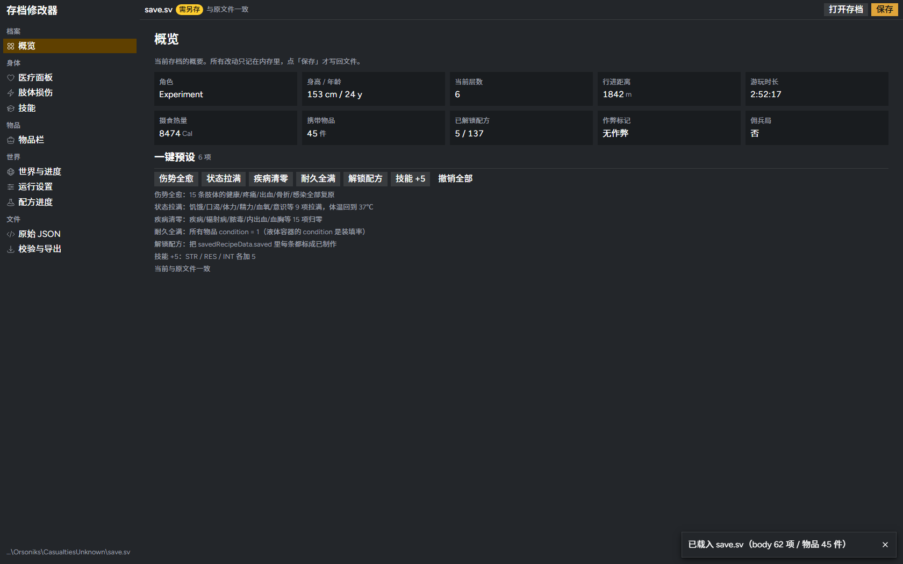
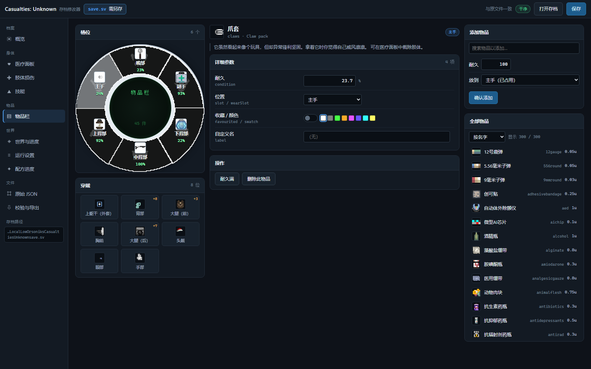
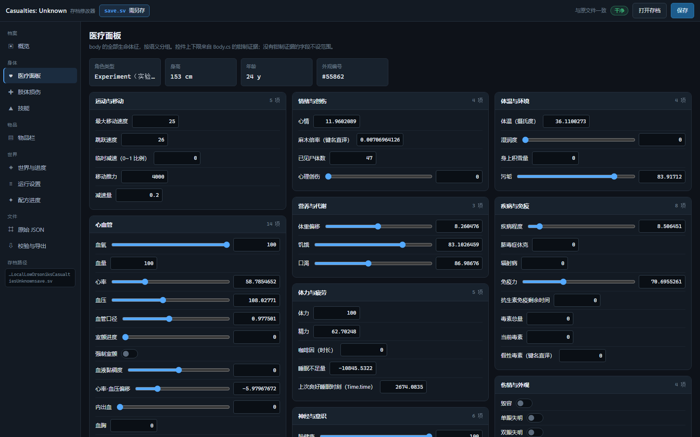
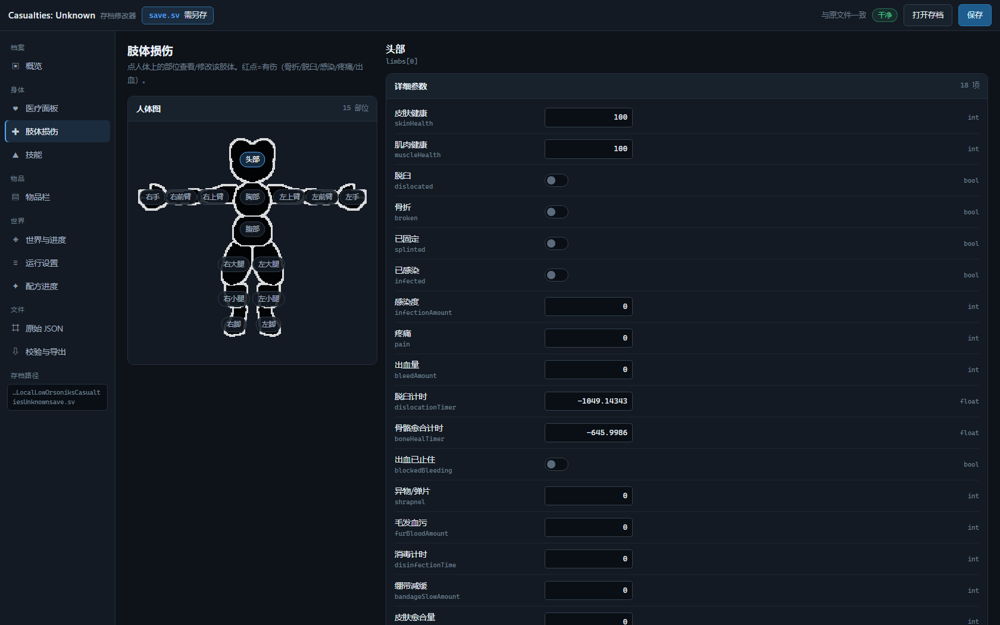

# Casualties: Unknown 存档修改器

《Casualties: Unknown》的**单文件、离线、免安装**存档修改器。双击 HTML 用 Edge / Chrome 打开，把 `save.sv` 拖进去就能改，改完一键写回原文件。

- 存档位置：`C:\Users\<你>\AppData\LocalLow\Orsoniks\CasualtiesUnknown\save.sv`
- 成品：`dist\CasualtiesUnknown存档修改器.html`（约 1.25 MB，数据与图标全部内嵌，断网可用）
- 需要 Edge / Chrome 103+（依赖浏览器原生 gzip 流 `CompressionStream`）

## 界面

| 概览 + 一键预设 | 物品栏（径向六槽 / 容器 / 液体） |
|---|---|
|  |  |

| 医疗面板（62 项生命体征，语义分组） | 肢体损伤（剪影热区 + 18 项参数） |
|---|---|
|  |  |


## 快速开始

1. **先关掉游戏** —— 游戏读档成功后会**删除** `save.sv`（`SaveSystem.cs:445`），开着游戏改没有意义。
2. 复制一份 `save.sv` 做备份（工具不会自动备份）。
3. 双击 `dist\CasualtiesUnknown存档修改器.html` → 点右上角「打开存档」，或直接把文件**拖进窗口**。
4. 左侧切页签改数值，改动会实时记在顶栏（「已修改 N 处」，改过的行有琥珀色标记）。
5. 点右上角「保存」→ 直接覆盖原文件（浏览器支持文件句柄时）；不支持就退化成**下载一个新的 save.sv**。

## 能改什么

| 页签 | 内容 | 规模 |
|---|---|---|
| 概览 | 存档摘要 + 7 个一键预设（伤势全愈 / 状态拉满 / 疾病清零 / 耐久全满 / 解锁配方 / 技能 +5 / 撤销全部） | — |
| 医疗面板 | 存档 `body` 全部字段，按语义分组，带范围滑块 | 62 项 |
| 技能 | STR / RES / INT 与经验、上下限、增益倍率 | 3×7 |
| 肢体损伤 | 15 条肢体的皮肤 / 肌肉 / 疼痛 / 出血 / 骨折 / 感染 / 假肢等 | 15×18 |
| 物品栏 | 现有物品：耐久（液体容器显示**装填量 ml/容量**）、位置、8 色染色、液体内容（改量 / 换液体 / 加一种 / 删一种）、收藏、自定义名、删除；**物品库 300 件可搜索添加**，可放进空槽位或已有容器 | 300 件 / 75 种液体 |
| 世界与进度 | 层数、行进距离、游玩时长、掉落 / 陷阱倍率、角色外观、`cheatedSave` | 14 项 |
| 运行设置 | 本局难度倍率（布尔开关 / 数值+游戏内上下限 / 下拉选项） | 51 项 |
| 配方进度 | 137 条配方的「已制作」与 INT，可搜索、可全解锁 | 137 条 |
| 原始 JSON | 完整存档明文预览（带行号） | — |
| 校验与导出 | 结构校验 + 全部改动清单 + 写盘 | — |

## 几条必须知道的规则

1. **`cheatedSave`**：读档时若为 `true`，本次运行的成就被禁用（`SaveSystem.cs:435-439`）。手动改档本身不会被检测（无校验和、无签名），但把这项设成 true 等于自曝。
2. **6 个槽位** = `0 主手 / 1 副手 / 2 嘴部 / 3 上背部 / 4 中背部 / 5 下背部`。序号只能取 `Body.slots` 的数组顺序：`InventorySlot.slot` 字段在 prefab 里恒为 0，运行时才由 `InventorySlot.Start()` 回写。
3. **同槽位多物品靠容器**：读档时该位置第一件物品占位，其余同位置物品塞进它的 `Container`；宿主不是容器就会报错并丢弃（`SaveSystem.cs:318-342`）。所以物品列表里有"背包 + 缩进内容物"的层级。
4. **整数别写成小数**：读档用 `Convert.ChangeType` 逐字段赋值（`SaveSystem.cs:246-263`）。实测 `int` 字段给小数**不报错**，而是被**静默四舍五入**（47.5 → 48），所以校验把它标成错误。
5. **文本是纯 ASCII**：游戏用 `Encoding.ASCII` 读写档（`SaveSystem.cs:458/469`），中文一律转成 `\uXXXX` 再写出，否则会变成 `?`。
6. **染色编号就是游戏里那 8 个色块**（`Item.cs:32-41`，索引 0~7）。
7. **液体容器的"耐久"就是装填率**：`WaterContainerItem.UpdateCondition()` 里 `item.condition = CurrentTotal / Capacity`（`WaterContainerItem.cs:231-234`），所以这类物品没有独立耐久。界面给的是「装填量」ml 输入，填多少会按比例重算每一份液体并同步 `condition`；液体弹窗里加 / 删 / 改体积也会自动同步。
8. **不能改数组长度的地方**：`limbs`(15)、`itemComponents`（与 `items` 等长）、`savedRecipeData.saved`(137，与游戏配方表下标一一对应)。工具会同步维护前两项，并校验第三项。
9. **物品描述是 Unity TMP 富文本**：存档语言包里带 `<color="red">` / `<i>` 之类标签，界面按白名单转成 HTML 渲染（红色警告句能正常显示），列表悬浮提示则剥成纯文本。

## 构建

```bash
node build.js              # 生成 dist/CasualtiesUnknown存档修改器.html
node build.js --selftest   # 额外生成 dist/selftest.html（35 项断言）
node tools/audit.js        # 审计数据表与游戏源码是否一致
```

构建只依赖 Node.js（无第三方包）。

> **仓库不含游戏解包素材**：`work/decompile/`（反编译 C#）、`work/art/out/`（贴图）在本仓库被 `.gitignore` 排除。
> 想从源码重建 dist，需要自己用 ilspycmd / UnityPy 从游戏目录导出素材，提取脚本见 `work/tools/`、`work/art/`；
> 缺少贴图时构建不会失败，只是图标退回首字符占位。

## 目录结构

```
dist/CasualtiesUnknown存档修改器.html   ← 成品，双击即用
src/
  theme.css      全站唯一的设计系统（变量 → 基础 → 组件 → 页面 → 响应式）
  core.js        状态 / gzip / ASCII 转义 / 富文本 / 控件工厂 / 校验
  panels.js      10 个面板，只用 theme.css 的组件拼装
  app.js         外壳：导航 / 文件读写 / 启动
  template.html  单文件模板（构建时注入）
  selftest.js    浏览器内自检断言
build.js         把 src + work/data + 贴图打成单文件
tools/           独立审计与数据提取脚本
work/data/*.json 元数据表：物品 / 配方 / 运行设置 / 容器 / 液体 / 肢体 / 身体字段
work/tools/      从游戏程序集与语言包提取数据的 Python 脚本（可复跑）
work/verify/     独立读档校验器（Mono.Cecil 读游戏 DLL 真实字段类型，复现 TryLoadGame）
docs/            界面规范与改造记录、截图
```

以下目录**仅本地存在、不入库**：`work/decompile/`（反编译源码）、`work/art/out/`（解包贴图）、`work/save.json`、`UI草图/`。

## 数据可信度

存档格式与全部元数据都是**反编译游戏本体 + 解析游戏资产 + 读官方中文包**得到的，没有一条是猜的：

| 数据 | 来源 | 校验 |
|---|---|---|
| 存档格式 | `SaveSystem.cs`（gzip + JSON + 反射赋值） | 原档解压 23082 字节，字段逐一对应 `Body`/`Limb`/`Skills` 声明 |
| 物品库 300 件 | `Item.cs` 的 `GlobalItems.Add(...)` 300 处注册 | id 唯一，存档里 45 件全部命中 |
| 中文名/描述 | `Lang\zh-CN.json` 的 `main` 表 | 300/300 命中，0 缺失 |
| 配方 137 条 | `Recipes.SetUpRecipes()` | 与 `savedRecipeData.saved` 长度一致，index 顺序逐个对齐 |
| 运行设置 51 项 | `RunSettings.settingTypes` | 与存档实际 51 个 key 完全对应 |
| 容器 25 个 | UnityPy 解析 `resources.assets` 的 `Container` 组件 | 31/31 容器实例布局校验通过 |
| 液体 75 种 / 容量 54 件 | `Liquids.cs` 的 `Registry`、`Item.cs` 的 `LiquidItemInfo.capacity` | 中文名 75/75 命中；容量与外部整理表 54/54 一致 |
| 槽位 6 个 | `Body` prefab 的 `Body.slots` PPtr 顺序 | 与官中键名、代码用法三方一致 |
| 身体字段 80 / 肢体 15 | `Body.cs`、`Limb.cs` 声明 + 官中 `other` 表 | 每条范围带 `file:line` 证据 |


## 已知限制

- 只处理 `save.sv`；`settings.json`、`keybinds.json` 不在范围内。
- 液体的透明度在存档里没有记录，颜色一律按游戏 `LiquidType.color` 的 RGB 显示（丢弃 alpha）。
- 缺少贴图时会退回首字符占位图标（仓库不含解包贴图，属预期行为）。
- 改档属于自担风险的行为，请自留备份。

## 许可与免责

代码以 [MIT](LICENSE) 许可发布。游戏《Casualties: Unknown》的文本、贴图、数据结构等版权归 **Orsoniks** 及各自权利人所有，不在本许可范围内；本仓库不包含反编译源码与解包贴图原图。`dist/` 成品仅供修改本人存档使用，请自行确认符合当地法律与游戏 EULA。若权利人提出异议，仓库维护者会立即移除相关内容。
